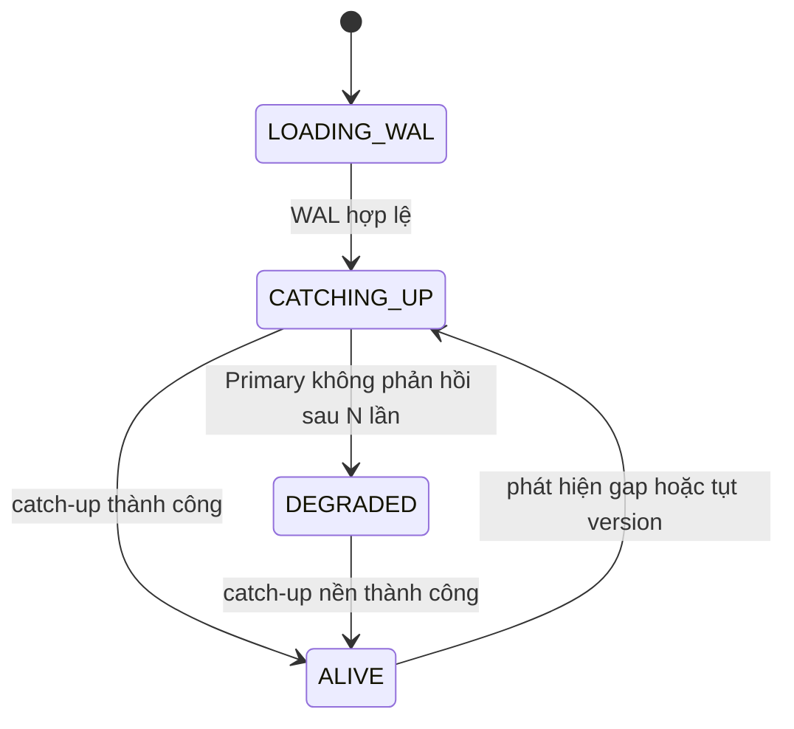
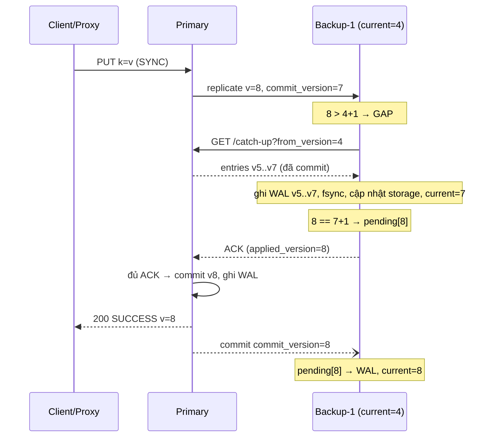

# REVIEW VAI TRÒ SINH VIÊN 2 — Backup Replica Nodes & Catch-Up Recovery

> **Phạm vi review:** toàn bộ repo (`backup_node/`, `primary_node/`, `client_proxy/`, `tests/`, `docker-compose.yml`, `README.md`, `PROTOCOL_SPEC.md` v4.1)
> **Ngày review:** 09/11/2026
> **Mục đích:** để cả nhóm nắm phần Backup còn thiếu gì, cần làm gì, và những điểm SV1, SV2, SV3 phải thống nhất với nhau.

> **Cập nhật 16/11/2026:** Các mục 0, 2, 3 đã được viết lại để phản ánh trạng thái triển khai Backup hiện tại. Các phần thiết kế và kịch bản vẫn giữ lại làm cơ sở trao đổi.

---

## 0. TÓM TẮT NHANH

1. **Backup đã triển khai** WAL liên tục, Prepare/Commit, API đọc, phát hiện gap, catch-up khi khởi động, retry khi Primary lỗi và anti-entropy định kỳ. Trạng thái hiện được theo dõi qua `/health`; `/debug/state` hỗ trợ kiểm thử.
2. **Phân kỳ được giữ an toàn:** nếu Primary báo version thấp hơn WAL Backup, node chuyển `DEGRADED`, tiếp tục phục vụ dữ liệu cục bộ, từ chối mọi `/replicate` bằng NACK `DIVERGED` và không áp dụng catch-up đến khi tiến trình khởi động lại.
3. **Pending cũ được giảm thiểu bằng `PENDING_TTL` (mặc định 3 giây),** nhưng đây là heuristic. Pending vẫn có thể bị commit trong cửa sổ TTL; fix đầy đủ cần Primary gửi `entry_id`/`commit_entry_id`.
4. **Tình trạng nhóm:** các phần Backup đã có unit test và test cụm thật. Proxy vẫn là stub; việc Primary phát ID để Backup xác minh pending còn chờ SV1.

---

## 1. TRÁCH NHIỆM CỦA SV2 (THEO README & PROTOCOL_SPEC)

| # | Trách nhiệm | Nguồn |
| :-: | :--- | :--- |
| 1 | Lưu trữ bền vững vào `backup_wal.jsonl` (tự viết, không dùng DB có sẵn) | README mục 1 |
| 2 | Pha Prepare `POST /api/v1/replicate`: đưa bản ghi vào `pending`, áp dụng các bản ghi `pending` có `ver <= commit_version` | Spec 3.1 |
| 3 | Pha Commit `POST /api/v1/commit`: đẩy `pending` xuống WAL và `storage` | Spec 3.2 |
| 4 | API đọc `GET /api/v1/read/{key}`, JSON trả về giống hệt Primary, hỗ trợ tombstone | Spec 3.3 + 2.2 |
| 5 | Trả `503 {"detail": "NODE_CATCHING_UP"}` khi đang catch-up | Spec 3.3 |
| 6 | Phát hiện thiếu version (gap) và gọi `GET /api/v1/catch-up` của Primary | Spec 3.1 bước 2 |
| 7 | Tự đồng bộ bù sau khi sập hoặc khởi động lại | README mục 1 |
| 8 | `GET /api/v1/health` trả `current_version` thật, `role: "BACKUP"` và `status` là `ALIVE`, `CATCHING_UP` hoặc `DEGRADED` | Spec 2.4 |

---

## 2. HIỆN TRẠNG `backup_node/`

| Hạng mục | Yêu cầu | Hiện trạng | Đánh giá |
| :--- | :--- | :--- | :-: |
| `GET /health` | `current_version` thật, status động | Trả version đã commit và `ALIVE`/`CATCHING_UP`/`DEGRADED` (`node.py`, `main.py`) | ✅ |
| `POST /replicate` | Prepare, duplicate, gap, NACK | Lưu pending liên tục; gap gọi catch-up; duplicate ACK; node phân kỳ trả NACK `DIVERGED` | ✅ |
| `POST /commit` | Commit liên tục và idempotent | Áp dụng tiền tố liên tục; thiếu pending thì trả `COMMITTED` và catch-up nền; bỏ qua commit cũ | ✅ |
| `GET /read/{key}` | Format chung, tombstone, chặn khi catch-up | Đọc local khi `ALIVE`/`DEGRADED`; trả 503 `NODE_CATCHING_UP` khi catch-up | ✅ |
| WAL `backup_wal.jsonl` | Append-only, fsync, khôi phục | Append/fsync trước khi cập nhật RAM; kiểm tra liên tục và cắt dòng cuối lỗi | ✅ |
| Catch-up và phát hiện gap | Nạp lại dữ liệu Primary đã commit | Catch-up khi khởi động/gap; single-flight, deadline trong replicate và retry nền | ✅ |
| Anti-entropy | Phát hiện commit bị mất | Probe `/health` theo `SYNC_INTERVAL`; catch-up khi Primary có version mới | ✅ |
| Pending cũ | Không commit nhầm lần ghi đã huỷ | Bỏ pending sau `PENDING_TTL`; ID chưa được Primary gửi nên vẫn còn rủi ro trong TTL | ⚠️ |
| Primary thấp version hơn Backup | Không ACK dữ liệu lệch lịch sử | Cờ `diverged` sticky, NACK `DIVERGED`, đọc local và giữ `DEGRADED` | ✅ |
| Kiểm thử | Unit và test cụm thật | `test_backup_node.py` và `test_backup_cluster.py`, gồm fault injection | ✅ |
| `Dockerfile`, `requirements.txt` | Chạy được Backup | Có dependency và thư mục dữ liệu riêng | ✅ |
| Service `backup1`, `backup2` trong compose | Mỗi node một volume, đúng env | Đúng; `depends_on` chưa đợi Primary sẵn sàng (xem mục 8) | ⚠️ |

---

## 3. DANH SÁCH VIỆC CẦN LÀM

### P0 — Bắt buộc (thiếu thì không hoàn thành vai trò)

- [x] **Cấu hình từ env:** `NODE_ID`, `PORT`, `PRIMARY_URL`, `DATA_DIR`; mỗi Backup dùng WAL riêng.
- [x] **Trạng thái trong RAM:** version đã commit, storage, pending, trạng thái catch-up và `asyncio.Lock`.
- [x] **WAL liên tục:** JSONL append-only, `flush()` + `os.fsync()`, ghi đĩa trước khi cập nhật RAM.
- [x] **Khôi phục WAL:** cắt dòng cuối lỗi; từ chối dòng hỏng ở giữa hoặc version không liên tục.
- [x] **`/replicate`:** duplicate ACK, prepare version kế tiếp, gap catch-up; NACK nếu không xử lý được.
- [x] **`/commit`:** commit tiền tố liên tục và idempotent.
- [x] **`/read/{key}` và `/health`:** đúng version đã commit, tombstone và trạng thái catch-up/degraded.
- [x] **Catch-up khi khởi động và retry:** gọi Primary, backoff khi lỗi.

### P1 — Edge case và phục hồi

- [x] Commit thiếu pending và single-flight catch-up; không giữ Lock trong lúc gọi HTTP.
- [x] Ghi catch-up theo lô và dọn pending đã được dữ liệu chuẩn từ Primary thay thế.
- [x] Anti-entropy mặc định mỗi 5 giây và tiếp tục retry khi Primary gặp lỗi.
- [x] Khi Primary không liên lạc được, phục vụ local read trong `DEGRADED`.
- [x] Pydantic kiểm tra request; log có tag; mỗi Backup dùng `DATA_DIR` riêng.
- [x] Pending cũ bị loại sau `PENDING_TTL` mặc định 3 giây. Đây là giảm thiểu; pending còn trong TTL vẫn có thể bị commit.
- [ ] **Fix đầy đủ pending cũ bằng `entry_id`/`commit_entry_id`:** Backup đã nhận các field tuỳ chọn, nhưng Primary chưa gửi. Chờ SV1.

### P2 — Điểm cộng

- [x] `/api/v1/debug/state`, `CATCHUP_DELAY_MS` và phát hiện Primary có version thấp hơn Backup.
- [x] Unit test `TestClient` với `FakePrimary` và test tích hợp cụm thật.
- [ ] Snapshot hoặc nén WAL; hiện chỉ là hướng phát triển được nêu trong báo cáo.

---

## 4. LỖ HỔNG VÀ ĐIỂM CHƯA RÕ TRONG THIẾT KẾ GỐC v4.0

> Các mục dưới đây ghi lại vấn đề trong thiết kế gốc v4.0; trạng thái hiện tại được đối chiếu với code và tests. Các đề xuất còn mở cần SV1 chốt; mục 4.5 cần SV3 phối hợp.

### 4.1 [NGHIÊM TRỌNG] Pending của lệnh ghi đã bị huỷ có thể bị commit nhầm

Spec 3.1 cho phép ghi đè `pending[v]` khi Primary gửi lại version `v` sau một lần trả 503. Vấn đề: nếu Backup **không nhận được** bản gửi lại, `pending[v]` cũ vẫn nằm đó và sẽ bị commit khi có `commit_version >= v`.

**Trạng thái:** Backup loại pending đã quá `PENDING_TTL` (mặc định 3 giây) rồi lấy lại dữ liệu từ Primary. Đây là heuristic; pending vẫn có thể bị commit trong cửa sổ TTL. Fix đầy đủ bằng ID chờ SV1; xem T7.

**Kịch bản tái hiện** (ban đầu cả 3 node ở `v=4`):

| Bước | Sự kiện | Primary | backup-1 | backup-2 |
| :-: | :--- | :--- | :--- | :--- |
| 1 | Tắt backup-2. Client gửi `PUT x=A` ở chế độ SYNC → `v=5` | Thiếu ACK → **503**, vẫn ở `v=4` | ACK, `pending[5]=A` | (đang tắt) |
| 2 | Bật lại backup-2. `docker pause kv_backup1` | | | |
| 3 | Client gửi `PUT x=B` ở chế độ QUORUM, W=2 → `v=5` | Có ACK của backup-2 → commit `v5 = B` | Không nhận được | `pending[5]=B` → commit |
| 4 | `docker unpause kv_backup1`. Client gửi `PUT y=C` → `v=6`, `commit_version=5` | | Bước 1 áp dụng `pending[5]` = **A** ❌ | |

**Kết quả:** backup-1 lưu `x=A` ở version 5, Primary lưu `x=B`. **Dữ liệu lệch nhau mà không ai biết.** Proxy cũng không phát hiện được vì `node_version` vẫn khớp.

**Đề xuất sửa** (SV1 sửa khoảng 5 dòng):
- Mỗi log entry có thêm trường `entry_id` (`uuid4`) do Primary sinh ra.
- Payload `/replicate` có thêm `commit_entry_id`, là `entry_id` của bản ghi tại `commit_version`. Body `/commit` cũng thêm `commit_entry_id`.
- Backup chỉ áp dụng `pending[commit_version]` khi `entry_id` khớp. Nếu không khớp thì bỏ pending đó và catch-up từ Primary.
- Chỉ cần kiểm tra 1 id là đủ an toàn. Lý do: Primary đã tuần tự hoá mọi lệnh ghi bằng `write_lock`, và Backup chỉ nhận vào `pending` bản ghi có `version == current_version + 1`, nên lúc nào `pending` cũng chỉ có **tối đa 1 bản ghi hợp lệ**.

*Phương án yếu hơn:* Primary gửi `POST /api/v1/abort {"version": v}` mỗi khi trả 503. Cách này không triệt để, vì chính gói abort cũng có thể bị mất.

### 4.2 Commit gửi tới Backup không có pending tương ứng

`broadcast_commit_async` gửi commit tới **tất cả** Backup (`replication.py:63-74`, `main.py:198`), kể cả node đã không ACK. Ngoài ra mỗi commit chạy trong một task riêng nên **có thể tới không đúng thứ tự**. Spec gốc v4.0 chưa nói Backup phải làm gì khi `pending` không có version cần commit.
→ **Đề xuất ban đầu cho spec:** Backup áp dụng được tới đâu thì dừng ở đó (không nhảy qua chỗ thiếu), trả `COMMITTED`, rồi chạy catch-up nền. Commit cũ tới muộn thì bỏ qua.

**Trạng thái:** Đã triển khai và kiểm thử: commit chỉ áp dụng tiền tố liên tục, luôn trả `COMMITTED`, catch-up chạy nền khi thiếu pending; commit cũ được bỏ qua.

### 4.3 Timeout 2 giây của Primary và việc catch-up giữa lúc xử lý replicate

Ở SYNC và QUORUM, Primary chờ ACK tối đa **2.0 giây** và chỉ gửi **1 lần** (`replication.py:108`). Nếu Backup phải catch-up nhiều bản ghi ngay trong lúc xử lý `/replicate` mà mất quá 2 giây, Primary coi như Backup không ACK.

Tình huống này xảy ra **thường xuyên chứ không hiếm**. Primary gửi ASYNC qua hàng đợi FIFO, còn SYNC/QUORUM thì gửi thẳng không qua hàng đợi. Vì vậy khi trộn chế độ, ví dụ ASYNC `v=5` rồi SYNC `v=6`, gói `v=6` có thể tới Backup trước `v=5`. Backup thấy gap và phải catch-up.

- Đề xuất: Backup đặt giới hạn thời gian cho catch-up trong luồng replicate, khoảng 1.5 giây. Không kịp thì trả 503 và tiếp tục catch-up ở nền.
- (Tuỳ chọn cho SV1) Thêm tham số `limit` cho `/catch-up` để phân trang.
- ✅ **Đã kiểm tra: không bị deadlock.** Primary giữ `write_lock` khi chờ ACK, nhưng `/catch-up` không cần `write_lock` (`main.py:238-246`), nên Backup gọi ngược lại Primary được.

**Trạng thái:** Đã triển khai `REPLICATE_CATCHUP_DEADLINE` mặc định 1.5 giây, thấp hơn timeout ACK 2 giây của Primary; có unit test cho deadline và catch-up dùng chung.

### 4.4 Backup trả lời gì khi KHÔNG nhận được bản ghi?

Spec gốc v4.0 chỉ định nghĩa ACK. Đề xuất format từ chối:
```json
// 503 Service Unavailable
{ "status": "NACK", "node_id": "backup-1", "reason": "GAP_NOT_FILLED", "current_version": 4 }
```
`reason` có thể là `GAP_NOT_FILLED` hoặc `CATCHING_UP`. Primary hiện coi mọi phản hồi khác "200 + ACK" là thất bại (`replication.py:51-54`), nên format này dùng được ngay, chỉ cần ghi vào spec.

**Trạng thái:** Đã triển khai top-level NACK HTTP 503 với `GAP_NOT_FILLED`, `CATCHING_UP` và `DIVERGED`; có unit test.

### 4.5 Primary chết lúc Backup khởi động, và gói commit bị mất

- **Kẹt ở CATCHING_UP:** theo spec, đang catch-up thì trả 503 cho lệnh đọc. Nếu Backup khởi động đúng lúc Primary đang chết, Backup sẽ kẹt mãi ở `CATCHING_UP`. Khi đó **không node nào phục vụ đọc**, đi ngược mục tiêu "high availability" của Track C.
  → **Đề xuất:** thử lại N lần không được thì chuyển sang `DEGRADED` và phục vụ đọc bằng dữ liệu đang có trên máy, kèm `node_version` thật. Proxy tự đảm bảo Read-Your-Writes và Monotonic Reads bằng cách so `node_version`. Vẫn tiếp tục thử catch-up ở nền. **SV3 cần biết điểm này.**
- **Mất gói commit:** commit được gửi ngầm và không thử lại. Hàng đợi ASYNC bỏ bản ghi sau 2 lần gửi hỏng (`replication.py:32`). Nếu sau đó không còn lệnh ghi nào, Backup tụt version mãi mãi. Cần **đồng bộ định kỳ** (P1).
- **Bật cờ `is_catching_up` sớm:** FastAPI chạy trên asyncio, một luồng. Nếu chỉ bật cờ trong lúc ghi lô (đoạn code đồng bộ, không có `await`), request đọc không bao giờ chen vào được, nên nhánh 503 không bao giờ xảy ra. Hãy bật cờ **từ trước khi gọi HTTP catch-up** cho tới khi áp dụng xong.

**Trạng thái:** Đã triển khai ngưỡng `PRIMARY_FAILURES_BEFORE_DEGRADED`, phục vụ đọc cục bộ ở `DEGRADED`, retry và anti-entropy. Proxy cần so `node_version` cho Read-Your-Writes/Monotonic Reads; phần Proxy vẫn chờ SV3.

### 4.6 Backup có version cao hơn Primary

Nếu chỉ WAL của Primary bị mất (xoá riêng volume `primary_data`) còn Backup vẫn giữ dữ liệu, Primary sẽ đếm lại từ `v=1`. Backup thấy mọi bản ghi mới đều có `incoming_v <= current_version` nên coi là trùng lặp: vẫn ACK nhưng không lưu. Kết quả sai.
→ **Đề xuất:** khi catch-up hoặc health cho thấy `current_primary_version < current_version`, ghi log cảnh báo rõ ràng và chuyển sang `DEGRADED` (hoặc reset dữ liệu).
*Ghi chú:* `docker compose down -v` xoá cả 3 volume cùng lúc, nên khi chạy bình thường sẽ không gặp trường hợp này.

**Trạng thái:** Đã triển khai cờ `diverged` sticky. Khi phát hiện version Primary thấp hơn, Backup giữ `DEGRADED`, đọc local, NACK mọi replicate bằng `DIVERGED`, bỏ qua commit và không áp dụng catch-up đến khi tiến trình khởi động lại.

### 4.7 ACK không có nghĩa là đã ghi bền vững trên Backup (cần ghi vào báo cáo)

`pending` chỉ nằm trong RAM. Ở SYNC/QUORUM, ACK nghĩa là "Backup đã nhận", **chưa** phải "Backup đã ghi đĩa". Khi Backup sập thì không mất dữ liệu đã commit, vì Primary đã ghi WAL trước khi trả 200 và Primary là nguồn chuẩn để catch-up.

Tuy nhiên hệ thống **không có cơ chế bầu Primary mới**, nên Primary là điểm duy nhất nhận lệnh ghi. Nếu đĩa của Primary hỏng, các bản ghi Backup mới giữ ở `pending` cũng mất theo. Đây là giới hạn của thiết kế và nên nêu thẳng trong báo cáo, cùng phương án nâng cấp: ghi `pending` ra file riêng.

**Trạng thái:** Đúng với thiết kế hiện tại: pending chỉ ở RAM; ACK không đồng nghĩa với ghi bền vững trên Backup. Đây vẫn là giới hạn kiến trúc.

---

## 5. THIẾT KẾ ĐỀ XUẤT CHO BACKUP NODE

### 5.1 Các điều kiện luôn phải đúng (bất biến)

| ID | Bất biến |
| :-: | :--- |
| I1 | WAL của Backup chứa đúng các version `1..current_version`, liên tục, không trùng. |
| I2 | `storage` bằng đúng kết quả áp dụng WAL theo thứ tự. |
| I3 | Mọi version `<= current_version` đều đã được commit trên Primary. Backup không bao giờ commit thứ mà Primary chưa commit. |
| I4 | `node_version` trả cho Proxy bằng `current_version`, không tính `pending`. |
| I5 | `pending` chỉ chứa version lớn hơn `current_version`, thực tế chỉ có `current_version + 1`. |
| I6 | Chỉ ACK khi bản ghi đã nằm trong `pending` hoặc đã commit. |

### 5.2 Các trạng thái của Backup



### 5.3 Pseudocode

```python
# ---------- Trạng thái ----------
current_version = 0      # version lớn nhất ĐÃ COMMIT và đã ghi WAL
storage = {}             # key -> {"value", "version", "deleted"}
pending = {}             # version -> entry (thực tế chỉ có current_version + 1)
is_catching_up = True    # True từ lúc khởi động tới khi catch-up lần đầu xong
state_lock = asyncio.Lock()

def commit_one(entry):                     # chỉ gọi khi đang giữ state_lock
    assert entry["version"] == current_version + 1
    append_wal(entry)                      # write + flush + fsync TRƯỚC
    apply_to_storage(entry)                # rồi mới cập nhật RAM (PUT / tombstone DELETE)
    current_version += 1

def apply_pending_up_to(cv, cv_entry_id=None):
    while current_version < cv:
        e = pending.pop(current_version + 1, None)
        if e is None:
            return "GAP"                   # thiếu bản ghi → cần catch-up
        if e["version"] == cv and cv_entry_id and e.get("entry_id") != cv_entry_id:
            return "STALE"                 # pending cũ của lệnh đã bị huỷ (mục 4.1)
        commit_one(e)
    return "OK"

async def replicate(entry):
    for attempt in range(2):               # tối đa 1 lần catch-up
        async with state_lock:
            r = apply_pending_up_to(entry["commit_version"], entry.get("commit_entry_id"))
            v = entry["version"]
            if r == "OK":
                if v <= current_version:
                    return ACK             # trùng lặp
                if v == current_version + 1:
                    pending[v] = entry     # ghi đè pending cũ nếu có
                    if entry["commit_version"] >= v:   # ASYNC: Primary đã commit
                        commit_one(pending.pop(v))
                    return ACK
        if attempt == 0:
            await catch_up_single_flight(deadline=1.5)   # NGOÀI lock
    return NACK_503("GAP_NOT_FILLED")

async def commit(body):
    async with state_lock:
        r = apply_pending_up_to(body["commit_version"], body.get("commit_entry_id"))
    if r != "OK":
        schedule_background_catch_up()
    return {"status": "COMMITTED", "node_id": NODE_ID, "commit_version": body["commit_version"]}

async def catch_up_single_flight():
    # Nhiều request cùng thấy gap thì chỉ gọi HTTP 1 lần, các request khác chờ chung task này
    is_catching_up = True                  # bật TRƯỚC khi gọi HTTP (xem 4.5)
    try:
        data = await http.get(f"{PRIMARY_URL}/api/v1/catch-up",
                              params={"from_version": current_version})
        async with state_lock:
            batch = []
            for e in sorted(data["entries"], key=lambda e: e["version"]):
                if e["version"] == current_version + 1 + len(batch):   # chỉ lấy chuỗi liên tục
                    batch.append(e)
            append_wal_batch(batch)        # ghi hết rồi fsync 1 lần
            for e in batch:
                apply_to_storage(e)
                current_version = e["version"]
            drop_pending_le(current_version)   # dữ liệu từ Primary là chuẩn
    finally:
        is_catching_up = False
```

> Bản ghi lấy từ `/catch-up` luôn là **đã commit**. Bỏ qua trường `commit_version` bên trong các bản ghi này.

**Luồng khởi động:**
1. `load_wal()`: cắt dòng cuối bị ghi dở, kiểm tra version liên tục, dựng lại `storage` và `current_version`.
2. Chuyển sang `CATCHING_UP` và mở server.
3. Task nền catch-up với backoff 0.5s → 1s → 2s → … (tối đa 5s).
   - Thành công → `ALIVE`.
   - Thất bại quá N lần (ví dụ 5) → `DEGRADED`, vẫn cho đọc dữ liệu đang có, vẫn tiếp tục thử.
4. Task nền đồng bộ định kỳ mỗi 5s: gọi `/health` của Primary. Nếu Primary có `current_version` lớn hơn mình thì catch-up.

### 5.4 Luồng phát hiện gap



---

## 6. KỊCH BẢN KIỂM THỬ VÀ DEMO

Các kịch bản cụm thật nằm trong `tests/test_backup_cluster.py`; cột cuối ghép từng T-id với test đang bao phủ.

| ID | Kịch bản | Cách làm | Kết quả mong đợi | Test bao phủ |
| :-: | :--- | :--- | :--- | :--- |
| T1 | Ghi rồi đọc từ Backup | Gửi `write` SYNC, sau đó đọc từ Backup | Giá trị đúng, `node_version` bằng version của Primary | `test_t1_sync_write_is_readable_from_both_backups` |
| T2 | Xoá (tombstone) | Gửi `DELETE` SYNC, đọc lại từ Backup | `found=false`, `deleted=true`, `value=null` | `test_t2_sync_delete_keeps_tombstone_on_backups` |
| T3 | Khởi động lại bình thường | Dừng rồi khởi động lại Backup | Đọc lại đủ dữ liệu từ WAL, log có `[RECOVERY]` | `test_t3_backup_restart_recovers_wal` |
| T4 | Sập rồi bù dữ liệu | Dừng backup-1, ghi 20 lệnh (4 QUORUM, còn lại ASYNC), rồi bật lại | Version Primary/Backup khớp, log catch-up có 20 entry | `test_t4_backup_catches_up_twenty_missed_writes` |
| T5 | Gap sau khi Backup khởi động lại | Dừng backup-2, ghi ASYNC, bật lại rồi gửi thêm một ghi; thử thêm gap không thể lấp | Bù version và NACK gap không lấp được | `test_t5_restart_after_async_gap_and_rejects_unfillable_version` |
| T6 | SYNC thất bại rồi ghi lại | Dừng backup-2, gửi SYNC bị 503, sau đó QUORUM ghi giá trị khác | Backup-1 không lưu giá trị bị huỷ; giá trị mới được giữ | `test_t6_failed_sync_value_is_not_committed_and_quorum_replacement_wins` |
| T7 | Pending cũ (mục 4.1) | Làm theo bảng 4 bước; tạm dừng backup-1 bằng psutil ở bước ghi B | Pending A hết TTL hoặc được B thay thế; cuối cùng x=B, y=C, WAL liên tục | `test_t7_stale_sync_pending_does_not_overwrite_quorum_value` |
| T8 | WAL bị ghi dở | Thêm dòng cuối chưa hoàn chỉnh rồi khởi động lại | Tự cắt dòng cuối, không crash | `test_t8_torn_final_wal_line_is_truncated_on_restart` |
| T9 | Primary chết | Dừng Primary, đọc từ Backup; khởi động lại Backup khi Primary vẫn tắt | Đọc trả 200; Backup vào `DEGRADED` rồi tiếp tục thử lại | `test_t9_backup_serves_local_reads_while_primary_is_down` |
| T10 | Gửi trùng (idempotent) | Gửi cùng `replicate` và `commit` nhiều lần | WAL không có version trùng | `test_t10_duplicate_replicate_and_commit_do_not_duplicate_wal` |
| T11 | 503 khi đang catch-up | Đặt `CATCHUP_DELAY_MS`, khởi động Backup và đọc ngay | Nhận `503 NODE_CATCHING_UP` | `test_t11_reads_are_rejected_during_startup_catchup` |
| T12 | Trộn ASYNC, SYNC, QUORUM | Ghi xen kẽ 30 lệnh | Version và dữ liệu 3 node trùng khớp | `test_t12_mixed_consistency_writes_converge_on_all_nodes` |

T7 không xác định chắc chắn nhánh sửa lỗi nào đã ngăn A: sau khi resume, request replicate B từng bị buffer ở socket có thể vẫn được xử lý và ghi đè pending. Test xác minh kết quả cuối không có A, các node hội tụ và WAL không có version trùng.

**Kiểm tra cuối mỗi kịch bản:** so `/health` của 3 node, rồi đọc ngẫu nhiên vài key trên cả 3 node để chắc dữ liệu khớp nhau.

---

## 7. SV2 CẦN ĐÓNG GÓP GÌ CHO BÁO CÁO VÀ BUỔI THUYẾT TRÌNH

- **Sơ đồ:** luồng Prepare/Commit hai pha, luồng catch-up khi có gap (mục 5.4), luồng khởi động lại, sơ đồ trạng thái (mục 5.2).
- **Lập luận tính đúng:** giải thích các bất biến I1 đến I6, và vì sao "ghi WAL trước, cập nhật RAM sau" giúp không mất dữ liệu khi crash.
- **Số đo:**
  - Thời gian phục hồi (từ `docker start` tới khi `/health` báo `ALIVE`) theo số bản ghi bị lỡ: 10, 100, 1000, 10000.
  - Độ trễ đọc từ Backup so với đọc từ Primary.
  - Tỷ lệ lần đọc bị Proxy từ chối vì dữ liệu cũ (phối hợp SV3).
- **Các đánh đổi:**
  - Giữ `pending` trong RAM hay ghi ra đĩa.
  - fsync từng dòng hay theo lô.
  - Trả 503 khi đang catch-up hay phục vụ dữ liệu cũ (`DEGRADED`).
  - WAL tăng mãi, cần snapshot/compaction.
- **Giới hạn phạm vi:** không có bầu Primary mới, nên khi Primary chết hệ thống chỉ còn đọc được.

---

## 8. VẤN ĐỀ NGOÀI PHẠM VI SV2 (ĐỂ CẢ NHÓM BIẾT)

| Vấn đề | Vị trí | Người phụ trách | Mức độ |
| :--- | :--- | :-: | :-: |
| `proxy.py` vẫn là stub, chỉ có `/health`. Session, cache, Read-Your-Writes, Monotonic Reads, failover đều chưa có | `client_proxy/proxy.py` | SV3 | Cao |
| `quorum_w` không được kiểm tra: `quorum_w=1` thì commit dù không Backup nào nhận; `quorum_w > 3` thì luôn 503; `quorum_w <= 0` cũng lọt qua | `primary_node/main.py:135` | SV1 | TB |
| Hàng đợi ASYNC không giới hạn kích thước và bỏ bản ghi sau 2 lần gửi hỏng; Backup dựa vào anti-entropy để bù khi Primary đã commit | `primary_node/replication.py:26-34` | SV1 + SV2 | TB |
| `depends_on` chỉ chờ container khởi động, không chờ server sẵn sàng. Cần thử lại khi khởi động hoặc dùng `healthcheck` + `condition: service_healthy` | `docker-compose.yml:32-33, 49-50, 63-66` | SV2 + SV3 | TB |
| `/catch-up` trả toàn bộ log, không phân trang. Log dài sẽ dễ vượt timeout 2s (xem 4.3) | `primary_node/main.py:238-246` | SV1 | Thấp |
| Dòng `version: '3.8'` trong compose đã lỗi thời, Compose v2 sẽ cảnh báo | `docker-compose.yml:1` | Cả nhóm | Rất thấp |
| `/health` của Primary trả thêm trường `backups` không có trong spec (vô hại) | `primary_node/main.py:117` | SV1 | Rất thấp |

---

## 9. CẦN NHÓM CHỐT

| # | Nội dung | Người liên quan |
| :-: | :--- | :-: |
| 1 | Primary phát `entry_id`/`commit_entry_id` để đóng lỗ hổng pending cũ; spec v4.1 ghi rõ đây là đề xuất | SV1 + SV2 |
| 2 | Proxy kiểm tra `node_version` khi thực hiện Read-Your-Writes/Monotonic Reads với Backup `DEGRADED` | SV3 |
| 3 | Kiểm tra miền giá trị `quorum_w` | SV1 |
| 4 | Chạy và trình diễn các test cụm thật trong mục 6 ở môi trường nhóm | Cả nhóm |

---

## PHỤ LỤC: CHẠY BACKUP THẬT Ở LOCAL (KHÔNG DÙNG DOCKER)

Mỗi node chạy trong một terminal riêng và **phải có `DATA_DIR` riêng**.

**PowerShell:**
```powershell
$env:NODE_ID="backup-1"; $env:PORT="8001"; $env:DATA_DIR="./data/backup-1"; $env:PRIMARY_URL="http://localhost:8000"; python backup_node/main.py
```
```powershell
$env:NODE_ID="backup-2"; $env:PORT="8002"; $env:DATA_DIR="./data/backup-2"; $env:PRIMARY_URL="http://localhost:8000"; python backup_node/main.py
```

**Bash:**
```bash
NODE_ID=backup-1 PORT=8001 DATA_DIR=./data/backup-1 PRIMARY_URL=http://localhost:8000 python backup_node/main.py
NODE_ID=backup-2 PORT=8002 DATA_DIR=./data/backup-2 PRIMARY_URL=http://localhost:8000 python backup_node/main.py
```
